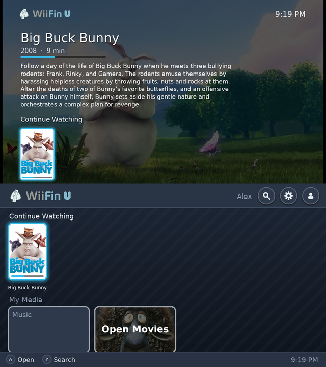
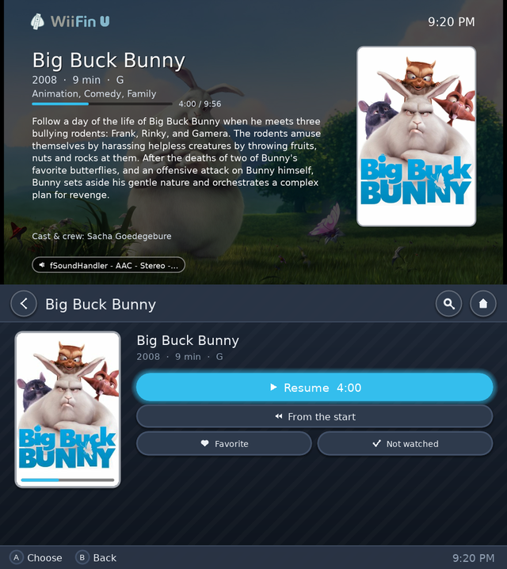
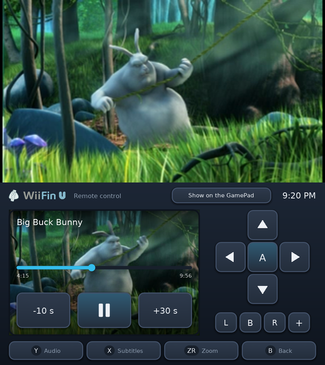
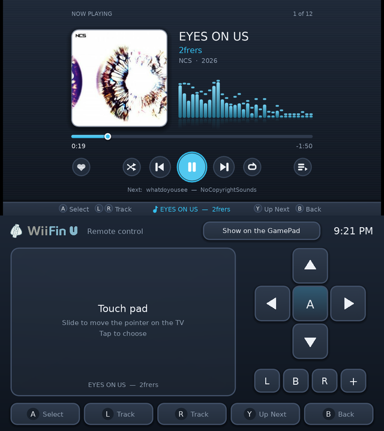

   
  <em>Jellyfin client for the Nintendo Wii U</em>

  
  &nbsp;
  
  &nbsp;
  
  &nbsp;
  
  &nbsp;
  

---

<strong>WiiFin U</strong> is a homebrew client for <a href="https://jellyfin.org">Jellyfin</a> on the <strong>Nintendo Wii U</strong>, a native Aroma app. 
It browses and plays your films, series and music on the console, in HD on the TV. It is the Wii U version of <a href="https://github.com/fabienmillet/WiiFin">WiiFin</a>, the Jellyfin client for the Wii: the same core, with screens of its own for the TV and the GamePad.

<table align="center">
  <tr>
    <td></td>
    <td></td>
  </tr>
  <tr>
    <td></td>
    <td></td>
  </tr>
</table>

The TV above, the GamePad below · <em>Big Buck Bunny</em> © Blender Foundation, <a href="https://peach.blender.org">peach.blender.org</a> (CC BY 3.0) · <em>EYES ON US</em> by 2frers, <a href="https://ncs.io">NCS</a>

---

## 📦 Install

1. A Wii U with [Aroma](https://aroma.foryour.cafe/).
2. Unzip `WiiFinU.zip` from the [latest release](https://github.com/fabienmillet/WiiFinU/releases) at the root of the SD card (`wiiu/apps/WiiFinU.wuhb`, and the font Chinese and Korean need); `WiiFinU.wuhb` alone in `sd:/wiiu/apps/` is enough for the other languages.
3. Start **WiiFin U** from the Wii U Menu and sign in to your Jellyfin server with your username and password, or with Quick Connect.

Settings, profiles and the log (`wiifinu.log`, for bug reports) are kept in `sd:/wiiu/apps/WiiFinU/`.

## ✨ Highlights

- **Two screens, as the Wii U Menu**: you browse on the GamePad (touch or buttons), the TV shows what is selected, big: its backdrop, synopsis, cast and the row it is in. On the GamePad alone, everything is on it
- **HD**: the interface is drawn at the TV's own resolution, sharp in 720p and 1080p; posters, covers and backdrops are fetched at that size
- **Films, series and music** from your Jellyfin: H.264 up to **1080p** with the console's own decoder; the server converts the rest (480p, 720p or 1080p, as you choose)
- During a video, the GamePad is a **remote**: the picture live, a bar to go anywhere, ±10 / 30 s, audio and subtitle tracks, zoom
- **Music** with WiiFin's visualizers and synced lyrics; it goes on while you browse
- Home rows (continue watching, next up, latest), libraries, series and seasons, search with the Wii U's keyboard
- **Profiles**: several accounts and servers, Quick Connect, servers found on the network
- **Remote control** from Jellyfin's dashboard and apps
- WiiFin's ten languages; GamePad, Pro Controller, Wii Remote and Classic Controller

Screens, buttons, video limits and how it is built: **[docs/WIIU.md](docs/WIIU.md)**.

## ⚠️ Project status

> 🚧 **Not released yet**: tested in the [Cemu](https://cemu.info) emulator so far, not on a console yet. Test builds will be shared on Discord.

- The video limits are cautious until they are measured on real consoles
- Picture subtitles (PGS, VobSub) are burned in by the server

## 🤝 Contributing

Pull requests, bug reports and ideas are welcome:

* 📘 The [contribution guidelines](CONTRIBUTING.md), and how to [build WiiFin U](docs/WIIU.md#building)
* 🌍 [Translating](lang/README.md) into your language
* 🐛 A [bug report](.github/ISSUE_TEMPLATE/bug_report.yml) (with `sd:/wiiu/apps/WiiFinU/wiifinu.log` from the SD card) or a 💡 [feature request](.github/ISSUE_TEMPLATE/feature_request.yml)

## 🙏 Credits

- [WiiFin](https://github.com/fabienmillet/WiiFin), whose core WiiFin U shares
- [wut](https://github.com/devkitPro/wut) and [SDL2's Wii U port](https://github.com/devkitPro/SDL) (zlib; its texture shader), [Moonlight for Wii U](https://github.com/GaryOderNichts/moonlight-wiiu) (GPL-3.0; its NV12 shader, and how it uses the console's H.264 decoder and keyboard)
- [FFmpeg](https://ffmpeg.org) (LGPL), [mbedTLS](https://www.trustedfirmware.org/projects/mbed-tls/) (Apache 2.0), [FreeType](https://freetype.org), [libjpeg-turbo](https://libjpeg-turbo.org), [libpng](http://www.libpng.org), [libmad](https://www.underbit.com/products/mad/) (GPL)

## 📜 License

This project is licensed under the **GPLv3**.
See the [LICENSE](LICENSE) file for more details.
