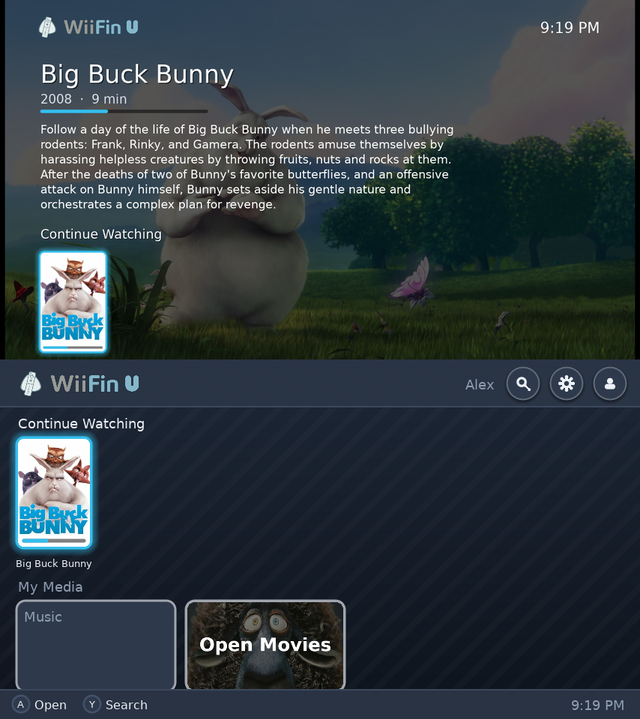
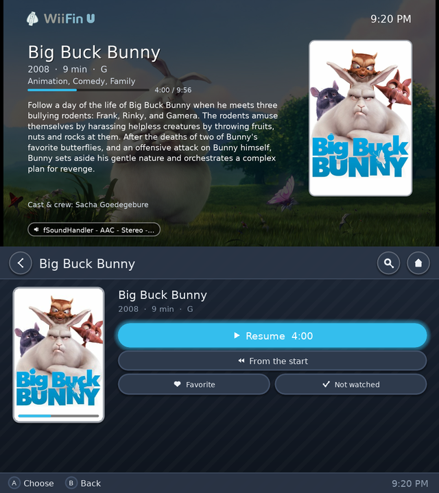
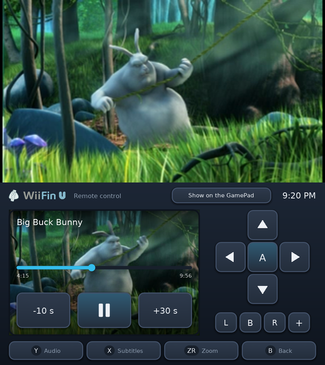
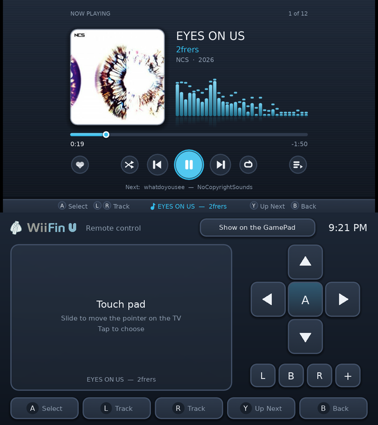

   
  <em>Jellyfin-Client für die Nintendo Wii U</em>

  
  &nbsp;
  
  &nbsp;
  
  &nbsp;
  
  &nbsp;
  

---

<strong>WiiFin U</strong> ist ein Homebrew-Client für <a href="https://jellyfin.org">Jellyfin</a> auf der <strong>Nintendo Wii U</strong>, eine native Aroma-App. 
Er durchsucht und spielt deine Filme, Serien und Musik auf der Konsole ab, in HD auf dem Fernseher. Er ist die Wii-U-Version von <a href="https://github.com/fabienmillet/WiiFin">WiiFin</a>, dem Jellyfin-Client für die Wii: derselbe Kern, mit eigenen Bildschirmen für Fernseher und GamePad.

<table align="center">
  <tr>
    <td></td>
    <td></td>
  </tr>
  <tr>
    <td></td>
    <td></td>
  </tr>
</table>

Oben der Fernseher, unten das GamePad · <em>Big Buck Bunny</em> © Blender Foundation, <a href="https://peach.blender.org">peach.blender.org</a> (CC BY 3.0) · <em>EYES ON US</em> von 2frers, <a href="https://ncs.io">NCS</a>

---

## 📦 Installation

1. Eine Wii U mit [Aroma](https://aroma.foryour.cafe/).
2. Entpacke `WiiFinU.zip` aus der [neuesten Version](https://github.com/fabienmillet/WiiFinU/releases) ins Hauptverzeichnis der SD-Karte (`wiiu/apps/WiiFinU.wuhb` und die Schrift für Chinesisch und Koreanisch); für die anderen Sprachen reicht `WiiFinU.wuhb` allein in `sd:/wiiu/apps/`.
3. Starte **WiiFin U** über das Wii-U-Menü und melde dich mit Benutzername und Passwort oder per Quick Connect an deinem Jellyfin-Server an.

Einstellungen, Profile und das Protokoll (`wiifinu.log`, für Fehlerberichte) liegen in `sd:/wiiu/apps/WiiFinU/`.

## ✨ Highlights

- **Zwei Bildschirme wie im Wii-U-Menü**: Du navigierst auf dem GamePad (per Touch oder Tasten), der Fernseher zeigt das Ausgewählte groß: Hintergrundbild, Inhalt, Besetzung und die Reihe, in der es steht. Nur mit dem GamePad ist alles darauf
- **HD**: Die Oberfläche wird in der Auflösung des Fernsehers gezeichnet, scharf in 720p und 1080p; Poster, Cover und Hintergründe werden in dieser Größe geladen
- **Filme, Serien und Musik** aus deinem Jellyfin: H.264 bis **1080p** mit dem Decoder der Konsole; den Rest wandelt der Server um (480p, 720p oder 1080p, nach Wahl)
- Während eines Videos ist das GamePad eine **Fernbedienung**: das Bild live, eine Leiste zum Springen, ±10 / 30 s, Audio- und Untertitelspuren, Zoom
- **Musik** mit den Visualisierungen von WiiFin und synchronisierten Songtexten; sie läuft beim Stöbern weiter
- Startseiten-Reihen (weiterschauen, als Nächstes, neu), Bibliotheken, Serien und Staffeln, Suche mit der Tastatur der Wii U
- **Profile**: mehrere Konten und Server, Quick Connect, im Netzwerk gefundene Server
- **Fernsteuerung** über das Dashboard und die Apps von Jellyfin
- Die zehn Sprachen von WiiFin; GamePad, Pro Controller, Wiimote und Classic Controller

Bildschirme, Tasten, Videogrenzen und das Kompilieren: **[docs/WIIU.md](../docs/WIIU.md)** (auf Englisch).

## ⚠️ Projektstatus

> 🚧 **Beta**: 0.1.0 ist eine Vorabversion, bisher im Emulator [Cemu](https://cemu.info) getestet, noch nicht auf einer Konsole. Berichte von einer echten Wii U sind sehr willkommen: Öffne ein Issue mit `sd:/wiiu/apps/WiiFinU/wiifinu.log`.

- Die Videogrenzen sind vorsichtig, bis sie auf echten Konsolen gemessen sind
- Bild-Untertitel (PGS, VobSub) brennt der Server ein

## 🤝 Mitmachen

Pull Requests, Fehlerberichte und Ideen sind willkommen:

* 📘 Die [Richtlinien für Beiträge](../CONTRIBUTING.md) und wie man [WiiFin U kompiliert](../docs/WIIU.md#building)
* 🌍 In deine Sprache [übersetzen](../lang/README.md)
* 🐛 Ein [Fehlerbericht](../.github/ISSUE_TEMPLATE/bug_report.yml) (mit `sd:/wiiu/apps/WiiFinU/wiifinu.log` von der SD-Karte) oder ein 💡 [Funktionswunsch](../.github/ISSUE_TEMPLATE/feature_request.yml)

## 🙏 Danksagungen

- [WiiFin](https://github.com/fabienmillet/WiiFin), dessen Kern WiiFin U teilt
- [wut](https://github.com/devkitPro/wut) und der [Wii-U-Port von SDL2](https://github.com/devkitPro/SDL) (zlib; sein Textur-Shader), [Moonlight für Wii U](https://github.com/GaryOderNichts/moonlight-wiiu) (GPL-3.0; sein NV12-Shader und wie es den H.264-Decoder und die Tastatur der Konsole nutzt)
- [FFmpeg](https://ffmpeg.org) (LGPL), [mbedTLS](https://www.trustedfirmware.org/projects/mbed-tls/) (Apache 2.0), [FreeType](https://freetype.org), [libjpeg-turbo](https://libjpeg-turbo.org), [libpng](http://www.libpng.org), [libmad](https://www.underbit.com/products/mad/) (GPL)

## 📜 Lizenz

Dieses Projekt steht unter der **GPLv3**.
Details in der Datei [LICENSE](../LICENSE).
