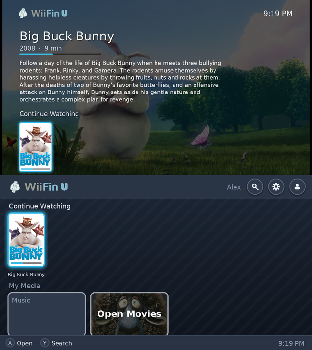
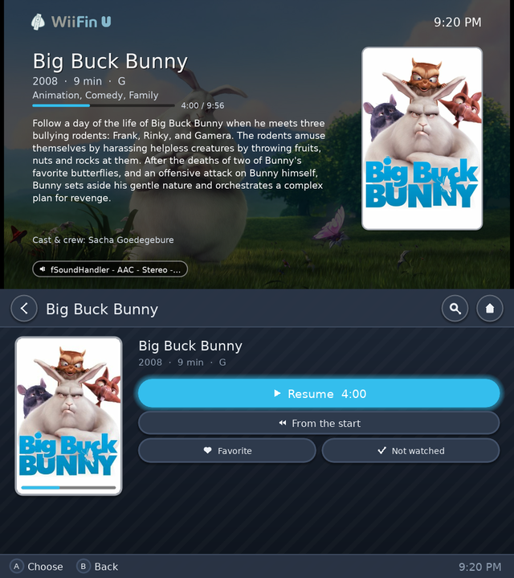
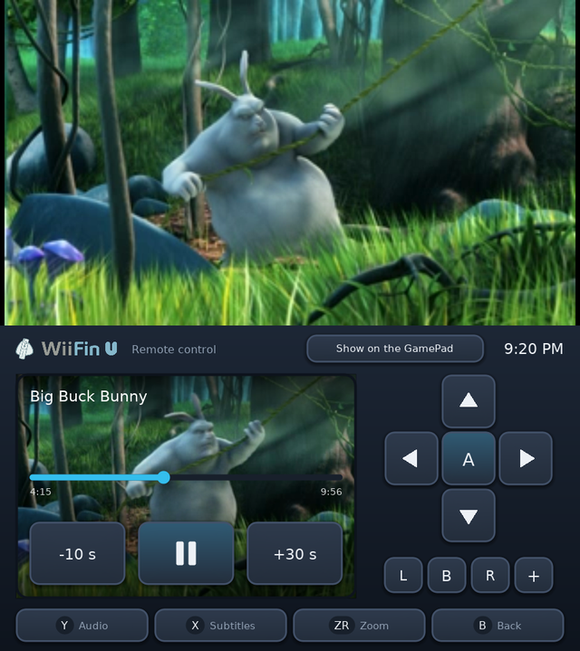
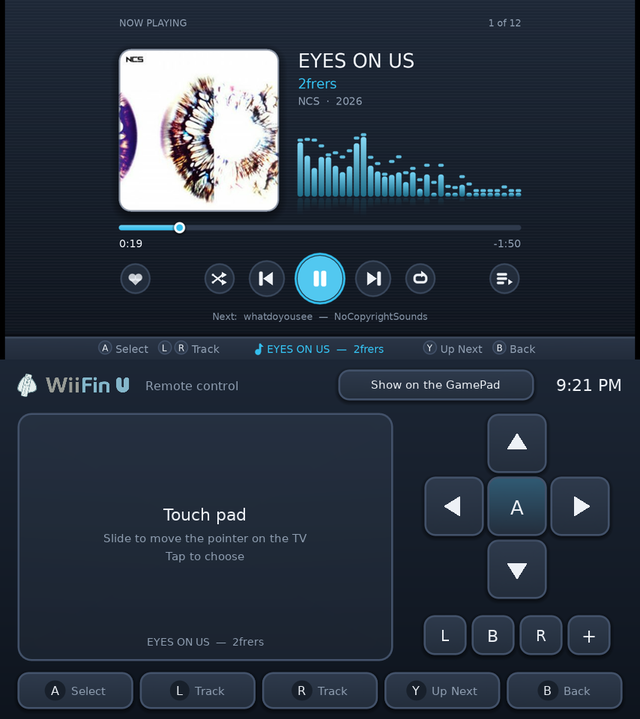

   
  <em>Cliente de Jellyfin para Nintendo Wii U</em>

  
  &nbsp;
  
  &nbsp;
  
  &nbsp;
  
  &nbsp;
  

---

<strong>WiiFin U</strong> es un cliente homebrew de <a href="https://jellyfin.org">Jellyfin</a> para <strong>Nintendo Wii U</strong>, una aplicación nativa de Aroma. 
Explora y reproduce tus películas, series y música en la consola, en HD en la tele. Es la versión para Wii U de <a href="https://github.com/fabienmillet/WiiFin">WiiFin</a>, el cliente de Jellyfin para Wii: el mismo núcleo, con pantallas propias para la tele y el GamePad.

<table align="center">
  <tr>
    <td></td>
    <td></td>
  </tr>
  <tr>
    <td></td>
    <td></td>
  </tr>
</table>

Arriba la tele, abajo el GamePad · <em>Big Buck Bunny</em> © Blender Foundation, <a href="https://peach.blender.org">peach.blender.org</a> (CC BY 3.0) · <em>EYES ON US</em> de 2frers, <a href="https://ncs.io">NCS</a>

---

## 📦 Instalación

1. Una Wii U con [Aroma](https://aroma.foryour.cafe/).
2. Descomprime `WiiFinU.zip` de la [última versión](https://github.com/fabienmillet/WiiFinU/releases) en la raíz de la tarjeta SD (`wiiu/apps/WiiFinU.wuhb` y la fuente que necesitan el chino y el coreano); para los demás idiomas basta `WiiFinU.wuhb` solo en `sd:/wiiu/apps/`.
3. Abre **WiiFin U** desde el menú de Wii U e inicia sesión en tu servidor de Jellyfin con tu usuario y contraseña, o con Quick Connect.

Los ajustes, los perfiles y el registro (`wiifinu.log`, para informar de errores) están en `sd:/wiiu/apps/WiiFinU/`.

## ✨ Lo más destacado

- **Dos pantallas, como el menú de Wii U**: navegas en el GamePad (táctil o con botones) y la tele muestra en grande lo seleccionado: su fondo, sinopsis, reparto y la fila en la que está. Con el GamePad solo, todo está en él
- **HD**: la interfaz se dibuja a la resolución de la tele, nítida en 720p y 1080p; pósteres, carátulas y fondos se cargan a ese tamaño
- **Películas, series y música** de tu Jellyfin: H.264 hasta **1080p** con el decodificador de la consola; el servidor convierte el resto (480p, 720p o 1080p, a elegir)
- Durante un vídeo, el GamePad es un **mando a distancia**: la imagen en directo, una barra para ir a cualquier punto, ±10 / 30 s, pistas de audio y subtítulos, zoom
- **Música** con los visualizadores de WiiFin y letras sincronizadas; sigue sonando mientras navegas
- Filas de inicio (seguir viendo, a continuación, novedades), bibliotecas, series y temporadas, búsqueda con el teclado de Wii U
- **Perfiles**: varias cuentas y servidores, Quick Connect, servidores encontrados en la red
- **Control remoto** desde el panel y las apps de Jellyfin
- Los diez idiomas de WiiFin; GamePad, mando Pro, Wiimote y mando Clásico

Pantallas, botones, límites de vídeo y compilación: **[docs/WIIU.md](../docs/WIIU.md)** (en inglés).

## ⚠️ Estado del proyecto

> 🚧 **Beta**: la 0.1.0 es una versión preliminar, probada de momento en el emulador [Cemu](https://cemu.info), todavía no en una consola. Los informes desde una Wii U real son muy bienvenidos: abre una issue con `sd:/wiiu/apps/WiiFinU/wiifinu.log`.

- Los límites de vídeo son prudentes hasta medirlos en consolas reales
- El servidor incrusta los subtítulos de imagen (PGS, VobSub)

## 🤝 Contribuir

Pull requests, informes de errores e ideas son bienvenidos:

* 📘 La [guía de contribución](../CONTRIBUTING.md) y cómo [compilar WiiFin U](../docs/WIIU.md#building)
* 🌍 [Traducir](../lang/README.md) a tu idioma
* 🐛 Un [informe de error](../.github/ISSUE_TEMPLATE/bug_report.yml) (con `sd:/wiiu/apps/WiiFinU/wiifinu.log` de la tarjeta SD) o una 💡 [petición de función](../.github/ISSUE_TEMPLATE/feature_request.yml)

## 🙏 Créditos

- [WiiFin](https://github.com/fabienmillet/WiiFin), cuyo núcleo comparte WiiFin U
- [wut](https://github.com/devkitPro/wut) y el [port de SDL2 para Wii U](https://github.com/devkitPro/SDL) (zlib; su shader de texturas), [Moonlight para Wii U](https://github.com/GaryOderNichts/moonlight-wiiu) (GPL-3.0; su shader NV12 y cómo usa el decodificador H.264 y el teclado de la consola)
- [FFmpeg](https://ffmpeg.org) (LGPL), [mbedTLS](https://www.trustedfirmware.org/projects/mbed-tls/) (Apache 2.0), [FreeType](https://freetype.org), [libjpeg-turbo](https://libjpeg-turbo.org), [libpng](http://www.libpng.org), [libmad](https://www.underbit.com/products/mad/) (GPL)

## 📜 Licencia

Este proyecto está bajo la licencia **GPLv3**.
Consulta el archivo [LICENSE](../LICENSE) para más detalles.
