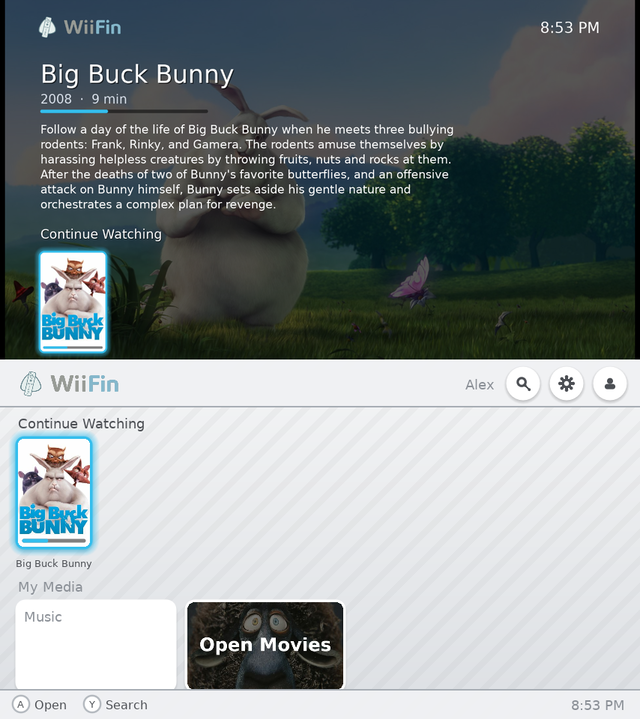
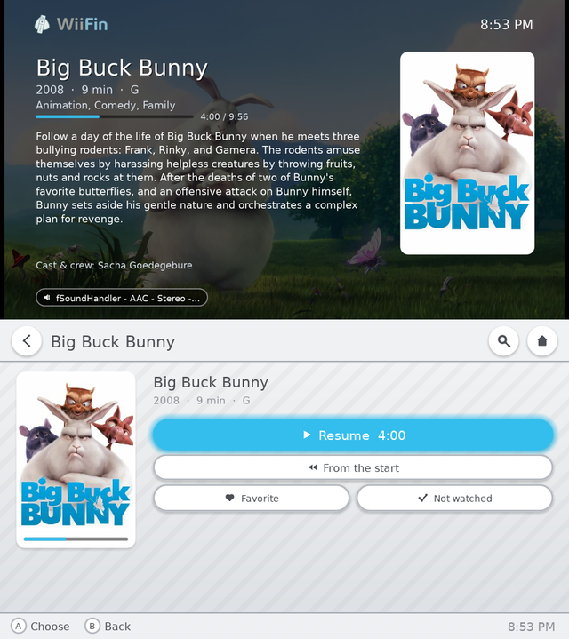
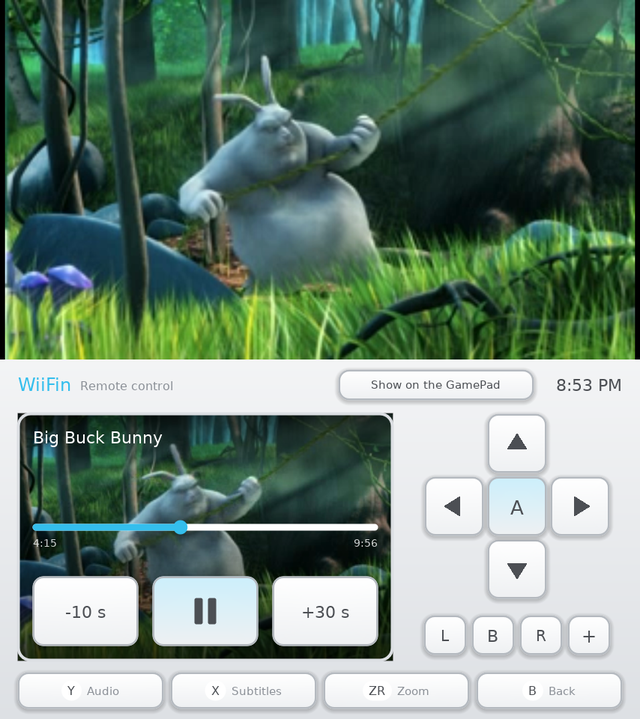
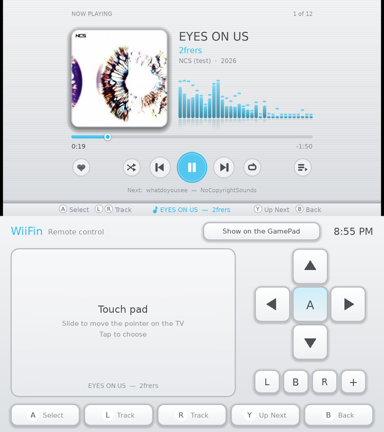

   
  <strong><big>WiiFin U</big></strong> 
  <em>Client Jellyfin pour la Nintendo Wii U</em>

  
  &nbsp;
  
  &nbsp;
  
  &nbsp;
  
  &nbsp;
  

---

<strong>WiiFin U</strong> est un client homebrew pour <a href="https://jellyfin.org">Jellyfin</a> sur <strong>Nintendo Wii U</strong>, une application Aroma native. 
Il parcourt et lit vos films, séries et musiques sur la console, en HD sur la télé. C'est la version Wii U de <a href="https://github.com/fabienmillet/WiiFin">WiiFin</a>, le client Jellyfin pour la Wii : le même cœur, avec des écrans à lui pour la télé et le GamePad.

<table align="center">
  <tr>
    <td></td>
    <td></td>
  </tr>
  <tr>
    <td></td>
    <td></td>
  </tr>
</table>

La télé en haut, le GamePad en bas · <em>Big Buck Bunny</em> © Blender Foundation, <a href="https://peach.blender.org">peach.blender.org</a> (CC BY 3.0) · <em>EYES ON US</em> de 2frers, <a href="https://ncs.io">NCS</a>

---

## 📦 Installation

1. Une Wii U avec [Aroma](https://aroma.foryour.cafe/).
2. Décompressez `WiiFinU.zip` de la [dernière version](https://github.com/fabienmillet/WiiFinU/releases) à la racine de la carte SD (`wiiu/apps/WiiFinU.wuhb`, et la police dont le chinois et le coréen ont besoin) ; `WiiFinU.wuhb` seul dans `sd:/wiiu/apps/` suffit pour les autres langues.
3. Lancez **WiiFin U** depuis le menu Wii U et connectez-vous à votre serveur Jellyfin avec votre nom d'utilisateur et votre mot de passe, ou par Quick Connect.

Les paramètres, les profils et le journal (`wiifinu.log`, pour signaler un bug) sont dans `sd:/wiiu/apps/WiiFinU/`.

## ✨ Points forts

- **Deux écrans, comme le menu Wii U** : vous naviguez sur le GamePad (au toucher ou aux boutons), la télé montre en grand ce qui est sélectionné : son image de fond, son résumé, sa distribution et la rangée où il se trouve. Avec le GamePad seul, tout est dessus
- **HD** : l'interface est dessinée à la résolution de la télé, nette en 720p et en 1080p ; affiches, pochettes et images de fond sont chargées à cette taille
- **Films, séries et musique** de votre Jellyfin : H.264 jusqu'en **1080p** avec le décodeur de la console ; le serveur convertit le reste (480p, 720p ou 1080p, au choix)
- Pendant une vidéo, le GamePad est une **télécommande** : l'image en direct, une barre pour aller n'importe où, ±10 / 30 s, pistes audio et sous-titres, zoom
- **Musique** avec les visualiseurs de WiiFin et les paroles synchronisées ; elle continue pendant la navigation
- Rangées d'accueil (reprendre, à suivre, nouveautés), bibliothèques, séries et saisons, recherche avec le clavier de la Wii U
- **Profils** : plusieurs comptes et serveurs, Quick Connect, serveurs trouvés sur le réseau
- **Commande à distance** depuis le tableau de bord et les applis Jellyfin
- Les dix langues de WiiFin ; GamePad, manette Pro, Wiimote et manette Classique

Écrans, boutons, limites vidéo et compilation : **[docs/WIIU.md](../docs/WIIU.md)** (en anglais).

## ⚠️ État du projet

> 🚧 **Pas encore publié** : testé dans l'émulateur [Cemu](https://cemu.info) pour l'instant, pas encore sur console. Des versions de test seront partagées sur Discord.

- Les limites vidéo sont prudentes tant qu'elles ne sont pas mesurées sur de vraies consoles
- Les sous-titres image (PGS, VobSub) sont incrustés par le serveur

## 🤝 Contribuer

Les pull requests, rapports de bug et idées sont les bienvenus :

* 📘 Le [guide de contribution](../CONTRIBUTING.md), et comment [compiler WiiFin U](../docs/WIIU.md#building)
* 🌍 [Traduire](../lang/README.md) dans votre langue
* 🐛 Un [rapport de bug](../.github/ISSUE_TEMPLATE/bug_report.yml) (avec `sd:/wiiu/apps/WiiFinU/wiifinu.log` de la carte SD) ou une 💡 [demande de fonctionnalité](../.github/ISSUE_TEMPLATE/feature_request.yml)

## 🙏 Remerciements

- [WiiFin](https://github.com/fabienmillet/WiiFin), dont WiiFin U partage le cœur
- [wut](https://github.com/devkitPro/wut) et le [portage Wii U de SDL2](https://github.com/devkitPro/SDL) (zlib ; son shader de textures), [Moonlight pour Wii U](https://github.com/GaryOderNichts/moonlight-wiiu) (GPL-3.0 ; son shader NV12, et sa façon d'utiliser le décodeur H.264 et le clavier de la console)
- [FFmpeg](https://ffmpeg.org) (LGPL), [mbedTLS](https://www.trustedfirmware.org/projects/mbed-tls/) (Apache 2.0), [FreeType](https://freetype.org), [libjpeg-turbo](https://libjpeg-turbo.org), [libpng](http://www.libpng.org), [libmad](https://www.underbit.com/products/mad/) (GPL)

## 📜 Licence

Ce projet est sous licence **GPLv3**.
Voir le fichier [LICENSE](../LICENSE) pour plus de détails.
