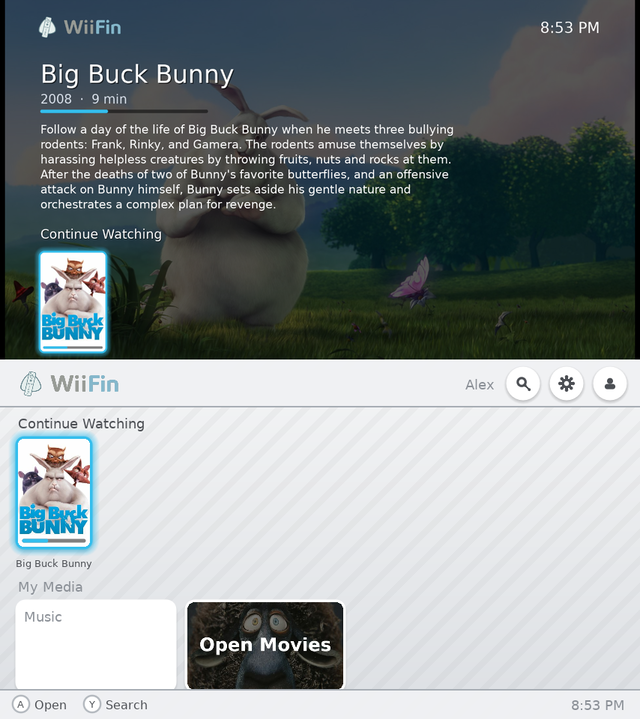
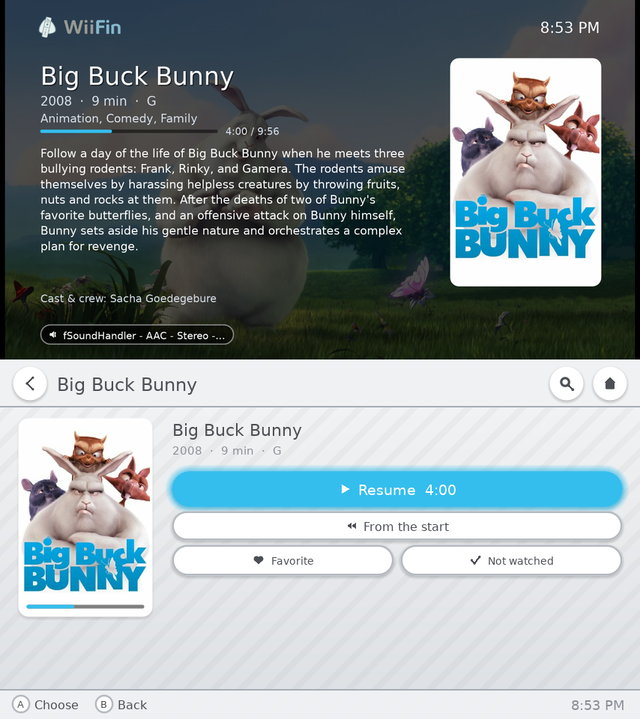
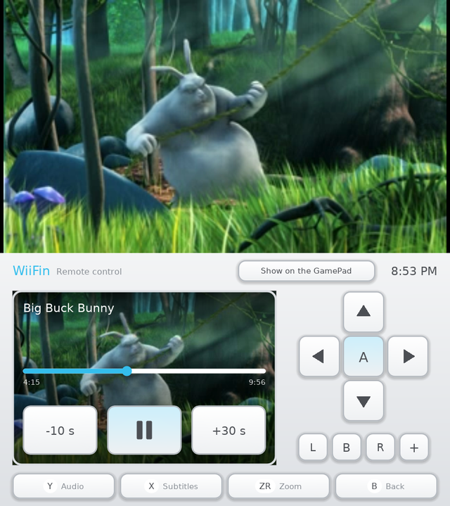
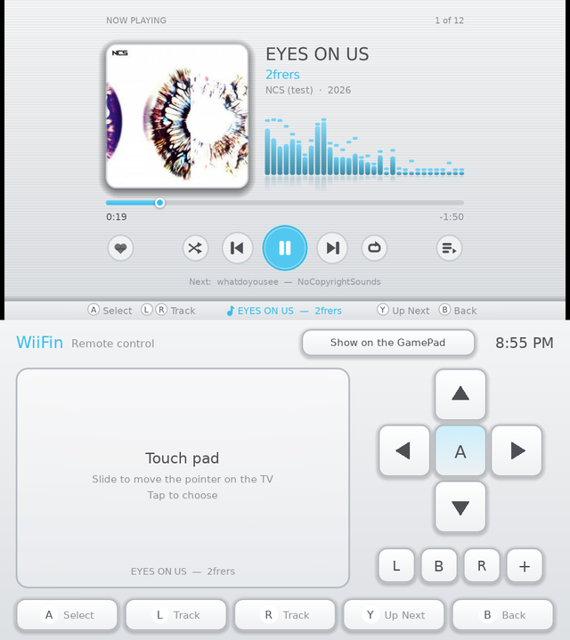

   
  <strong><big>WiiFin U</big></strong> 
  <em>Client Jellyfin per Nintendo Wii U</em>

  
  &nbsp;
  
  &nbsp;
  
  &nbsp;
  
  &nbsp;
  

---

<strong>WiiFin U</strong> è un client homebrew per <a href="https://jellyfin.org">Jellyfin</a> su <strong>Nintendo Wii U</strong>, un'app Aroma nativa. 
Sfoglia e riproduce i tuoi film, serie e musica sulla console, in HD sulla TV. È la versione per Wii U di <a href="https://github.com/fabienmillet/WiiFin">WiiFin</a>, il client Jellyfin per Wii: lo stesso nucleo, con schermate proprie per la TV e il GamePad.

<table align="center">
  <tr>
    <td></td>
    <td></td>
  </tr>
  <tr>
    <td></td>
    <td></td>
  </tr>
</table>

Sopra la TV, sotto il GamePad · <em>Big Buck Bunny</em> © Blender Foundation, <a href="https://peach.blender.org">peach.blender.org</a> (CC BY 3.0) · <em>EYES ON US</em> di 2frers, <a href="https://ncs.io">NCS</a>

---

## 📦 Installazione

1. Una Wii U con [Aroma](https://aroma.foryour.cafe/).
2. Estrai `WiiFinU.zip` dall'[ultima versione](https://github.com/fabienmillet/WiiFinU/releases) nella radice della scheda SD (`wiiu/apps/WiiFinU.wuhb` e il font che servono al cinese e al coreano); per le altre lingue basta `WiiFinU.wuhb` da solo in `sd:/wiiu/apps/`.
3. Avvia **WiiFin U** dal menu Wii U e accedi al tuo server Jellyfin con nome utente e password, oppure con Quick Connect.

Impostazioni, profili e il registro (`wiifinu.log`, per segnalare i bug) sono in `sd:/wiiu/apps/WiiFinU/`.

## ✨ In evidenza

- **Due schermi, come il menu Wii U**: navighi sul GamePad (al tocco o con i tasti), la TV mostra in grande ciò che è selezionato: lo sfondo, la trama, il cast e la riga in cui si trova. Con il solo GamePad, tutto è lì
- **HD**: l'interfaccia è disegnata alla risoluzione della TV, nitida in 720p e 1080p; locandine, copertine e sfondi sono caricati a quella dimensione
- **Film, serie e musica** dal tuo Jellyfin: H.264 fino a **1080p** con il decoder della console; il server converte il resto (480p, 720p o 1080p, a scelta)
- Durante un video il GamePad è un **telecomando**: l'immagine dal vivo, una barra per andare ovunque, ±10 / 30 s, tracce audio e sottotitoli, zoom
- **Musica** con i visualizzatori di WiiFin e i testi sincronizzati; continua mentre navighi
- Righe della home (continua a guardare, prossimi, novità), librerie, serie e stagioni, ricerca con la tastiera della Wii U
- **Profili**: più account e server, Quick Connect, server trovati in rete
- **Controllo remoto** dalla dashboard e dalle app di Jellyfin
- Le dieci lingue di WiiFin; GamePad, Pro Controller, Wiimote e Classic Controller

Schermi, tasti, limiti video e compilazione: **[docs/WIIU.md](../docs/WIIU.md)** (in inglese).

## ⚠️ Stato del progetto

> 🚧 **Non ancora pubblicato**: finora provato nell'emulatore [Cemu](https://cemu.info), non ancora su console. Le versioni di prova saranno condivise su Discord.

- I limiti video sono prudenti finché non saranno misurati su console vere
- I sottotitoli a immagine (PGS, VobSub) sono impressi dal server

## 🤝 Contribuire

Pull request, segnalazioni di bug e idee sono benvenute:

* 📘 Le [linee guida per contribuire](../CONTRIBUTING.md) e come [compilare WiiFin U](../docs/WIIU.md#building)
* 🌍 [Tradurre](../lang/README.md) nella tua lingua
* 🐛 Una [segnalazione di bug](../.github/ISSUE_TEMPLATE/bug_report.yml) (con `sd:/wiiu/apps/WiiFinU/wiifinu.log` dalla scheda SD) o una 💡 [richiesta di funzionalità](../.github/ISSUE_TEMPLATE/feature_request.yml)

## 🙏 Ringraziamenti

- [WiiFin](https://github.com/fabienmillet/WiiFin), di cui WiiFin U condivide il nucleo
- [wut](https://github.com/devkitPro/wut) e il [port di SDL2 per Wii U](https://github.com/devkitPro/SDL) (zlib; il suo shader delle texture), [Moonlight per Wii U](https://github.com/GaryOderNichts/moonlight-wiiu) (GPL-3.0; il suo shader NV12 e il modo in cui usa il decoder H.264 e la tastiera della console)
- [FFmpeg](https://ffmpeg.org) (LGPL), [mbedTLS](https://www.trustedfirmware.org/projects/mbed-tls/) (Apache 2.0), [FreeType](https://freetype.org), [libjpeg-turbo](https://libjpeg-turbo.org), [libpng](http://www.libpng.org), [libmad](https://www.underbit.com/products/mad/) (GPL)

## 📜 Licenza

Questo progetto è distribuito con licenza **GPLv3**.
Vedi il file [LICENSE](../LICENSE) per maggiori dettagli.
